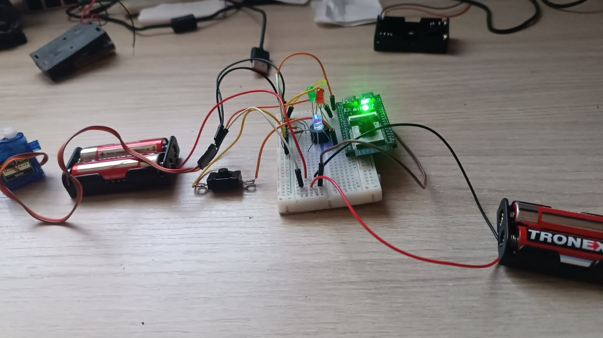

# Caja fuerte con ESP32 y reconocimiento facial

Sistema de control de acceso biométrico que integra un ESP32-S3 con un backend desarrollado en Python y Flask.

El dispositivo captura una imagen con una cámara OV2640. la envía al backend y OpenCV procesa el rostro mediante un modelo LBPH previamente entrenado. El servidor devuelve una decisión de apertura o rechazo y registra cada intento de acceso.

Este proyecto fue desarrollado como prototipo académico para explorar integración entre hardware. backend. visión por computador. APIs y pruebas automatizadas.

---

## Arquitectura

```text
Usuario
   |
   | Presiona pulsador
   v
ESP32-S3 + OV2640
   |
   | Captura JPEG
   | POST /upload
   v
Backend Flask
   |
   v
OpenCV
Detección facial
   |
   v
Modelo LBPH
   |
   +---- Autorizado ----> LED verde + Servo
   |
   +---- Rechazado -----> LED rojo + Buzzer

Todos los intentos
        |
        v
Historial web
```

---

## Prototipo físico



Prototipo utilizado durante las pruebas de integración entre el ESP32-S3. la cámara. los indicadores de estado y el mecanismo de apertura.

La imagen corresponde a una etapa de prototipado sobre protoboard.

---

## Cómo funciona

1. El usuario se posiciona frente a la cámara.
2. Presiona el pulsador.
3. El LED azul indica que el sistema está procesando.
4. La cámara OV2640 captura una imagen JPEG.
5. El ESP32-S3 envía la imagen al backend.
6. OpenCV detecta el rostro.
7. El modelo LBPH intenta identificar a la persona.
8. El backend responde con una decisión de acceso.
9. El ESP32 ejecuta la acción correspondiente.
10. El intento queda registrado en el historial.

### Acceso autorizado

- LED verde.
- Activación del servo motor.
- Registro del evento.

### Acceso rechazado

- LED rojo.
- Activación del buzzer.
- Registro del evento.
- Posible notificación por correo.

---

## Tecnologías

- Python 3.11
- Flask
- OpenCV
- LBPH Face Recognizer
- NumPy
- ESP32-S3
- OV2640
- Resend API
- Gunicorn
- pytest
- GitHub Actions

---

## Entrenamiento del modelo

El modelo LBPH fue entrenado previamente utilizando varias imágenes de las personas autorizadas.

El proceso incluye:

1. Captura de múltiples imágenes por persona.
2. Organización del dataset.
3. Conversión de imágenes a escala de grises.
4. Preparación de las regiones correspondientes al rostro.
5. Asignación de etiquetas.
6. Entrenamiento del modelo LBPH.
7. Generación de:

```text
model/lbph_model.yml
model/labels.json
```

El backend carga estos archivos durante el reconocimiento.

---

## Estructura principal

```text
Caja-fuerte-con-esp32/
│
├── app/
│   ├── __init__.py
│   ├── config.py
│   ├── events.py
│   ├── notifications.py
│   ├── recognition.py
│   └── routes.py
│
├── model/
├── tests/
├── docs/images/
├── .github/workflows/
├── .env.example
├── requirements.txt
├── requirements-dev.txt
├── pytest.ini
├── server.py
└── README.md
```

---

## Instalación

Clona el repositorio:

```bash
git clone https://github.com/sebasg-a/Caja-fuerte-con-esp32.git
cd Caja-fuerte-con-esp32
```

Crea un entorno virtual:

```bash
python -m venv venv
```

En Windows:

```powershell
.\venv\Scripts\Activate.ps1
```

Instala las dependencias:

```bash
pip install -r requirements.txt
```

Ejecuta el backend:

```bash
python server.py
```

El servidor estará disponible por defecto en:

```text
http://127.0.0.1:5000
```

---

## Pruebas

Instala las dependencias de desarrollo:

```bash
pip install -r requirements-dev.txt
```

Ejecuta:

```bash
python -m pytest -v
```

Actualmente se validan:

- Health check.
- Consulta del historial de eventos.
- Rechazo de uploads vacíos.

GitHub Actions ejecuta estas pruebas automáticamente en cambios dirigidos a `main`.

---

## Integración con ESP32

El prototipo original fue desarrollado con un ESP32-S3 y una cámara OV2640.

El firmware no se incluye como componente principal del repositorio porque puede variar dependiendo de:

- Modelo de ESP32.
- Cámara integrada o externa.
- Distribución de pines.
- Servo utilizado.
- Sensores o periféricos adicionales.
- Configuración de red.

El backend se mantiene independiente de la implementación específica del hardware.

Para integrarse con el sistema. el dispositivo debe ser capaz de:

1. Capturar o proporcionar una imagen JPEG.
2. Enviarla al endpoint `/upload`.
3. Procesar la respuesta JSON.
4. Ejecutar la acción indicada por el campo `accion`.

---

## Buenas prácticas

- Credenciales gestionadas mediante variables de entorno.
- `.env` excluido del repositorio.
- Imágenes y eventos generados durante la ejecución no se versionan.
- Backend organizado por responsabilidades.
- Pruebas automatizadas con pytest.
- Validación automática mediante GitHub Actions.

---

## Estado del proyecto

Prototipo académico funcional orientado a explorar integración hardware-software. backend. visión por computador y automatización de pruebas.

No está planteado como un sistema biométrico de seguridad para uso productivo o de alta criticidad.